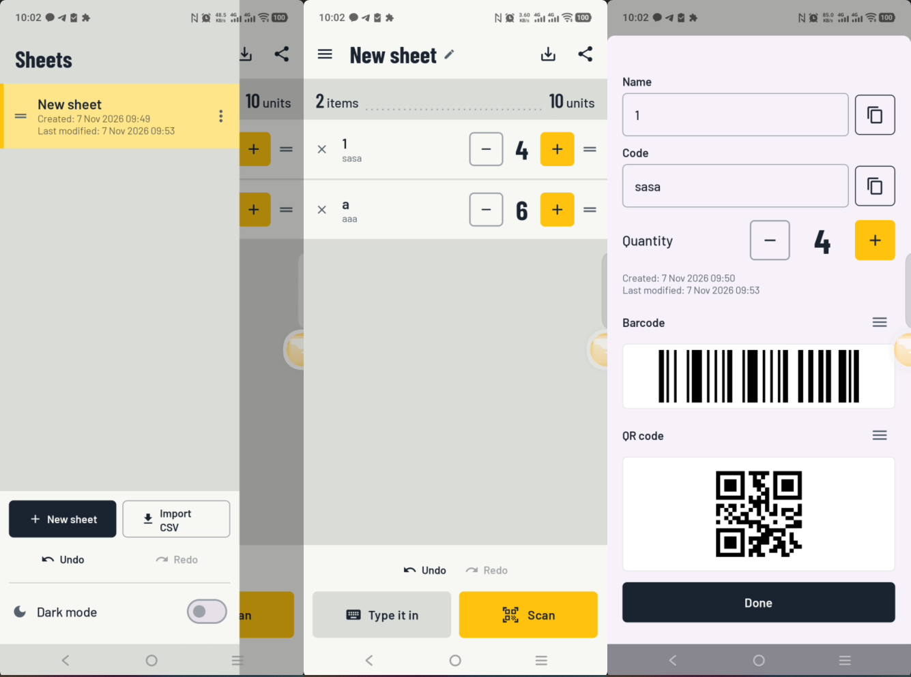

# Finn Opname

Finn Opname is an Android stock-counting app. Point the camera at a barcode or QR
code and the app adds one to that code's quantity; type a code in when the label
is damaged. Each sheet is a separate count — an aisle, a shelf, a delivery, a
freezer — so one phone can carry several counts side by side.

Everything stays on the phone. The app has no internet permission and sends
nothing anywhere.

> *Opname* is Dutch for a stocktake.



## Features

- **Scanning** — CameraX preview with ML Kit barcode recognition. A code is
  accepted only after three consecutive frames agree on it, and at most one scan
  per second is counted, so a shaky hand or a stack of labels cannot add
  phantom stock.
- **Sheets** — create, rename, duplicate, reorder and remove counts. The drawer
  shows each sheet's created and last-modified time.
- **Items** — tap a row to edit its name, code and quantity. The detail sheet
  shows the item's own timestamps and renders a Code 128 barcode and a QR code
  for its code.
- **Code images** — the barcode and QR code encode the code, never the name.
  Both can be shared or copied to the clipboard as an image.
- **Undo / redo** — item adds, edits, quantity changes, imports and deletions.
- **CSV** — export a sheet to a file or share it; import a CSV into a new sheet.
  Each row carries that item's created and last-modified time.
- **Dark mode** — toggle in the drawer; the system bars follow.

## Install

Download `FinnOpname.apk` from the [latest release](../../releases/latest) and
open it on the phone. Android will ask to allow installing from this source the
first time; the app asks for the camera the first time you scan.

Requires Android 7.0 (API 24) or newer.

The APK is signed with the project's debug key, which is fine for sideloading.
Android refuses to install an update signed with a different key, so install
future releases over the top of this one rather than uninstalling first.

## Build

Requires a JDK (21 is used here) and the Android SDK with API 36 installed.
Point `ANDROID_HOME` at the SDK, or create `local.properties` with
`sdk.dir=C\:\\path\\to\\Android\\Sdk`.

```bash
./gradlew :app:assembleDebug        # app/build/outputs/apk/debug/app-debug.apk
./gradlew :app:testDebugUnitTest    # unit tests
```

Android Studio can open the project directly. `debug.keystore` is not committed
(see `.gitignore`): the debug build type signs with it, so a fresh clone needs
its own copy, or a locally generated one with the same passwords and alias.

## How it is put together

| Layer | Where | What it does |
| --- | --- | --- |
| UI | `ui/MainScreen.kt`, `ui/DrawerContent.kt`, `ui/ScannerView.kt`, `ui/ItemDetailDialog.kt`, `ui/ManualAddDialog.kt` | Compose Material 3 screens, edge-to-edge with system-bar insets |
| State | `ui/InventoryViewModel.kt`, `ui/UndoAction.kt` | Active sheet, items, undo/redo stacks, scan throttle |
| Data | `data/InventoryEntity.kt`, `data/InventoryDao.kt`, `data/InventoryRepository.kt`, `data/AppDatabase.kt` | Room entities, DAOs and the repository; schema at version 4 with 1→2, 2→3 and 3→4 migrations |
| Utilities | `util/BarcodeUtil.kt`, `util/CsvHandler.kt`, `util/FeedbackUtil.kt`, `util/TimeFormat.kt` | ZXing image generation, CSV read/write, scan beep and vibration, timestamp formatting |

The database file is called `scancounter_database` and lives in the app's private
storage, so uninstalling the app removes every sheet.

## CSV format

Exported files are UTF-8, comma-separated, with a header row:

```csv
Name,Code,Quantity,Created,Last modified
Canned potato,123,4,2026-11-06 09:20,2026-11-07 09:14
"Soda Can, 330ml",889900,12,2026-11-07 08:02,2026-11-07 09:31
```

Dates are fixed `yyyy-MM-dd HH:mm` so the file reads the same in any spreadsheet.
The importer maps the Name, Code and Quantity columns and ignores the two dates;
it also accepts semicolon-separated files and headers named `Item`, `Barcode`,
`Qty` and so on.

## Permissions

- `CAMERA` — scanning only.
- `VIBRATE` — the short tick when a code is accepted.

No network, storage or location permission. Sharing an image or CSV goes through
a `FileProvider` cache URI handed to the app you pick.

## Versioning

The build carries its version in `app/build.gradle.kts` (`versionCode` and
`versionName`, currently `1.0.0.8` / `6`); release tags are `v<versionName>`.
Every release attaches the APK under the unversioned name `FinnOpname.apk`, so a
new build can be installed over the old file without renaming anything.
